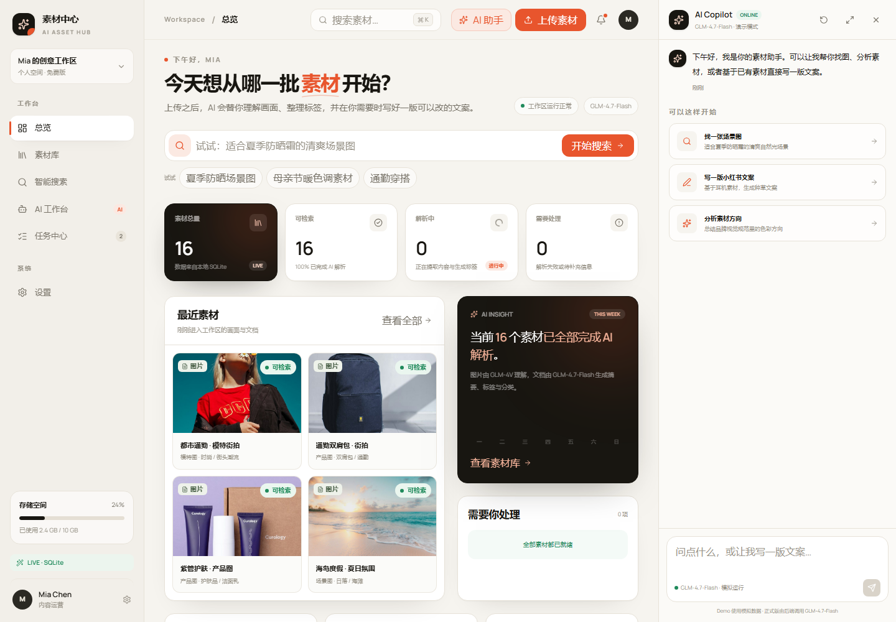
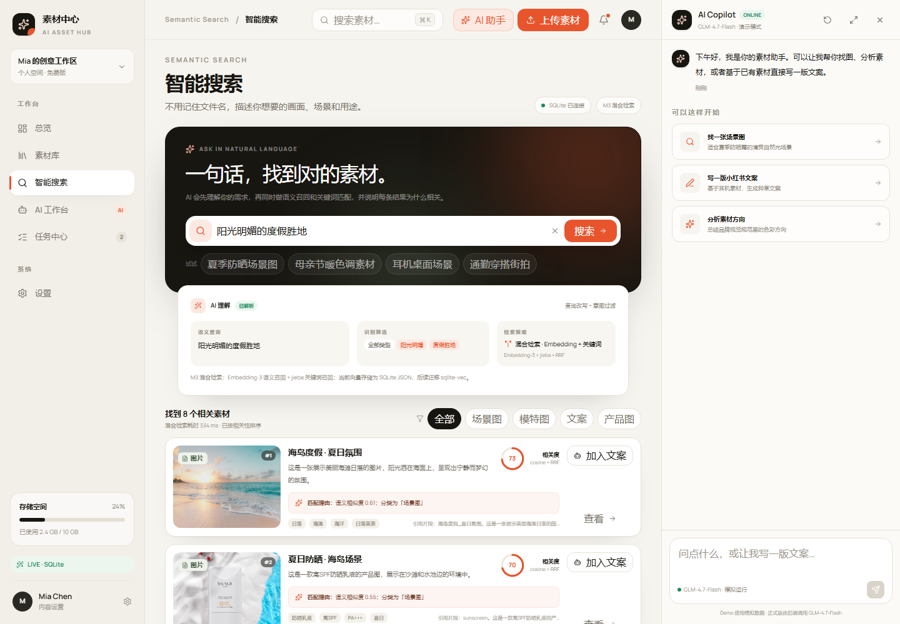
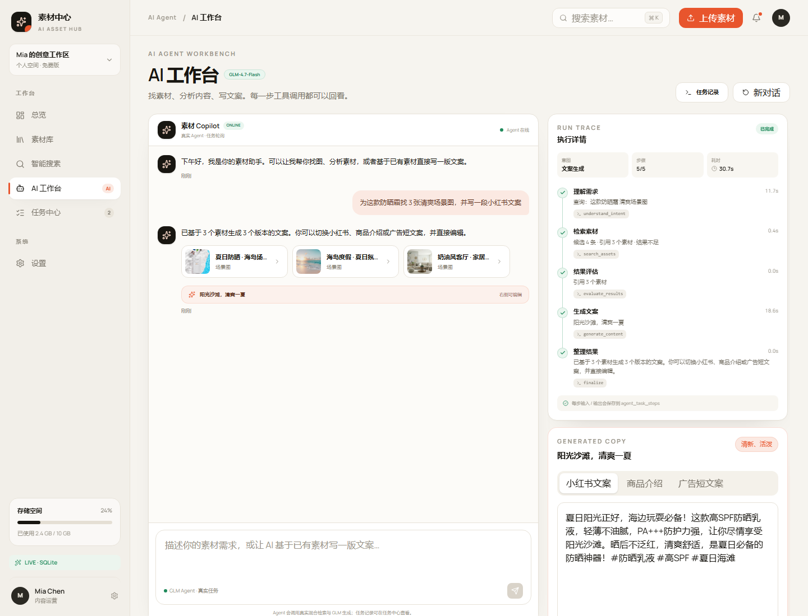
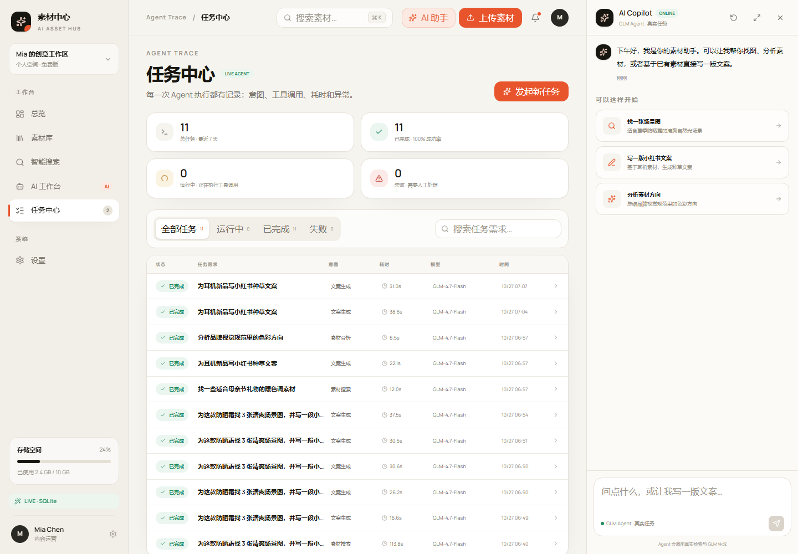
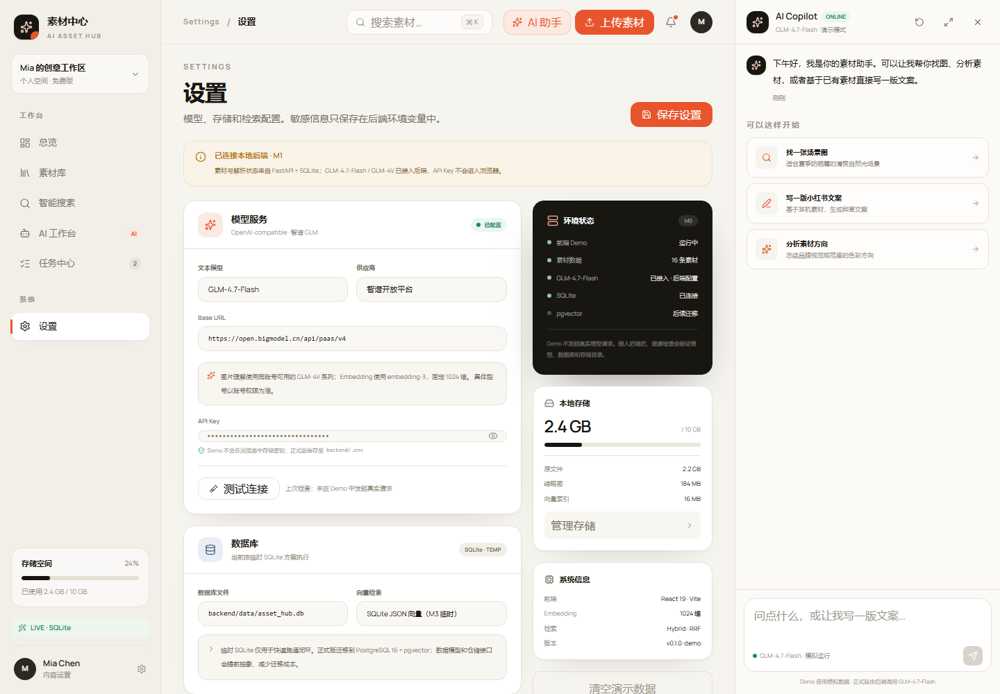
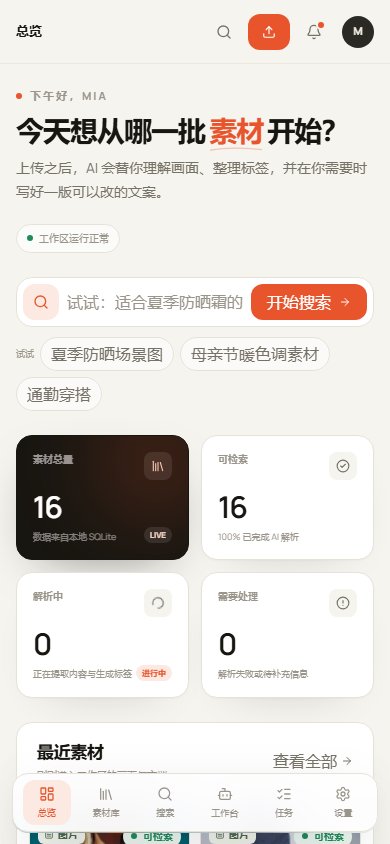
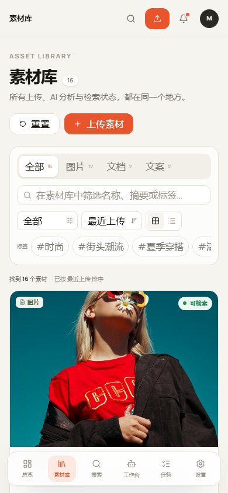

# AI 素材中心 · M0 高保真 Demo 预览

> Docker 运行地址：`http://127.0.0.1:8080/#/`
>
> 本地开发地址：`http://127.0.0.1:5173/#/`
>
> 代码目录：`demo/` + `backend/`
>
> 说明：前端已接入 FastAPI + SQLite；素材库、真实上传、详情、混合检索、
> LangGraph Agent 和任务中心均使用真实后端。后端不可用时自动回退 Demo 数据。

## 1. 总览

- 素材总量、可检索、解析中、失败状态；
- 最近素材、AI 洞察、待处理素材；
- 全局入口：上传、智能搜索、AI 工作台、任务中心。

## 2. 素材库

- 支持全部 / 图片 / 文档 / 文案分类；
- 搜索、分类、标签、状态筛选；
- 网格 / 列表切换；
- 点开素材可查看 AI 摘要、标签、文本分块和任务记录；
- 上传支持真实文件选择、拖拽、进度和模拟解析。

## 3. 智能搜索

> 已接入 M3 混合检索：Embedding-3 语义召回 + jieba 关键词召回；向量暂存 SQLite JSON。

- 自然语言查询理解；
- 展示语义查询、识别筛选条件、混合检索策略；
- 结果包含相关度、匹配理由、命中片段；
- 无结果状态和示例查询。

## 4. AI 工作台

- 真实 LangGraph 执行：理解需求 → 检索素材 → 结果评估 → 生成文案；
- 右侧展示节点耗时、工具调用和引用素材；
- 生成结果支持三个版本切换、直接编辑、复制；
- 生成依据与真实素材 ID 绑定。

## 5. 任务中心

- 真实任务列表、状态筛选、成功率；
- 展开查看每个节点的输入、输出、耗时和异常；
- 失败任务支持重试，并模拟状态恢复。

## 6. 设置

- GLM-4.7-Flash 配置占位；
- 明确 API Key 不进入前端，只存后端 `.env`；
- 临时 SQLite / sqlite-vec 方案；
- 存储用量与检索开关。

## 7. 移动端

## 建议重点体验

1. 素材库详情抽屉：AI 摘要、标签、分块、重新分析；
2. 上传示例文件：上传进度 → 解析中 → 可检索；
3. 智能搜索「适合夏季防晒霜的清爽场景图」：查看 AI 理解与匹配理由；
4. 智能搜索「无人机航拍海景」：查看无结果状态；
5. AI 工作台示例任务：观察步骤时间线、引用素材和可编辑文案；
6. 任务中心失败任务：点击重试；
7. 移动端：底部导航、筛选、搜索的适配。

## 预览后需要确认

- 视觉方向是否保留「明亮创作台」；
- 首页信息密度是否合适；
- 素材库卡片大小、筛选方式是否顺手；
- AI 工作台是否需要更强的对话感；
- 任务中心是否需要更多技术细节（token、成本、模型参数）；
- 移动端是否需要支持批量操作。

确认后进入 M1：FastAPI + SQLite 工程、素材 CRUD、本地存储与真实上传。
